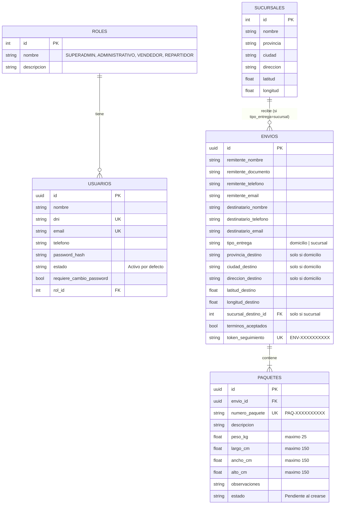

# Modelo de datos

Definido en `app/infrastructure/db/models.py` con SQLAlchemy 2.0 (mapeo declarativo con `Mapped[...]`). En desarrollo corre sobre SQLite (`sqlite+aiosqlite`); el esquema es compatible con PostgreSQL sin cambios de modelo, salvo el tipo UUID nativo (ver nota al final).

**Este documento detalla las 5 tablas núcleo (HU01–HU04).** El esquema completo de `models.py` tiene 15 tablas. Además de estas cinco, ya tienen lógica de aplicación: `historial_estados_paquete` (HU06, HU10, HU13), `notificaciones_envio` (HU05), `eventos_entrega` (HU13), `reclamos` ([HU07](../04-historias-de-usuario/hu07-reclamos.md)), `preguntas_frecuentes` ([HU08](../04-historias-de-usuario/hu08-preguntas-frecuentes.md)) y `repartidores`, `recorridos`, `recorrido_paquetes` y `alertas_recorrido` ([HU10](../04-historias-de-usuario/hu10-recorridos.md)); `posicion_actual_repartidor` queda para HU11. Ver el diseño completo, con la razón de ser de cada una, en el [Plan completo de base de datos (HU01–HU13)](./plan-base-de-datos-completo.md).

## Diagrama

## Notas por tabla

### `roles` / `usuarios` (HU01 / HU02)

- `roles` se siembra una única vez al iniciar la app (`infrastructure/db/seed.py:sembrar_roles`), con IDs fijos definidos en `domain/constants/roles.py:RolIdEnum` (1=SUPERADMIN, 2=ADMINISTRATIVO, 3=VENDEDOR, 4=REPARTIDOR). No hay endpoint para crear ni modificar roles.
- `usuarios.dni` y `usuarios.email` tienen constraint `UNIQUE` — es la base de la validación de duplicados de HU01 Escenario 4.
- `requiere_cambio_password` nace en `True` para todo empleado dado de alta por `POST /admin/empleados`, y en `False` para el Superadministrador sembrado por `sembrar_superadmin` (no le aplica el flujo de primer acceso de HU02).
- La relación `usuarios.rol` se carga siempre (`lazy="joined"`) porque casi todo flujo de autenticación necesita el nombre del rol.

### `sucursales` (soporte de HU03, HU06 y HU09)

- Se siembran 6 sucursales de ejemplo al iniciar la app (`sembrar_sucursales`), sin endpoint de alta — es un catálogo de solo lectura desde la API pública.
- `GET /sucursales` acepta filtros opcionales `provincia` y `ciudad` (HU09). Sin filtros devuelve el catálogo completo, que es lo que consume el selector de retiro en sucursal de HU03.
- La tabla es además el catálogo contra el que se valida la terminal donde se recibe un paquete en HU06 (`sucursal_id` del request) y el punto de retiro que HU09 informa en la vista pública.

### `envios` / `paquetes` (HU03 / HU04)

- Un `Envio` es la unidad de la relación remitente-destinatario-destino; puede contener uno o más `Paquete`. El `token_seguimiento` vive en `Envio`, no en `Paquete`: **un token siempre corresponde a todos los paquetes de un mismo envío** (HU04, Escenario 2).
- `tipo_entrega` decide qué bloque de columnas de destino aplica: si es `"domicilio"`, se completan `provincia_destino`/`ciudad_destino`/`direccion_destino` (y opcionalmente lat/long si el usuario marcó un punto en el mapa); si es `"sucursal"`, se completa `sucursal_destino_id` y los campos de domicilio quedan en `NULL`. Esta exclusión mutua se valida a nivel de contrato (`contracts/envios.py`), no con una constraint SQL — ver [HU03](../04-historias-de-usuario/hu03-registro-envios.md).
- `paquetes.numero_paquete` es único por paquete (para el código de barras de la planilla); `envios.token_seguimiento` es único por envío. Ambos se generan con el mismo esquema (`domain/rules/codigos_rules.py`) pero con prefijos distintos (`ENV-` / `PAQ-`).
- `paquetes.estado` nace en `"Pendiente"` (recién registrado por HU03) y hoy tiene dos transiciones implementadas: `EN_SUCURSAL_ORIGEN` cuando el vendedor lo recibe en la terminal ([HU06](../04-historias-de-usuario/hu06-recepcion-terminal.md)) y `ENTREGADO_EN_SUCURSAL` cuando se registra su retiro (HU13). Al iniciarse un recorrido de [HU10](../04-historias-de-usuario/hu10-recorridos.md) pasa a `EN_REPARTO` (corta distancia) o `EN_TRANSITO` (larga) y deja de estar ubicado en una sucursal. Si el envío es para retiro y se recibe en la misma sucursal elegida, pasa directo a `LISTO_PARA_RETIRO`. Solo `LISTO_PARA_RETIRO`, `EN_SUCURSAL` y `EN_SUCURSAL_DESTINO` habilitan el retiro de HU13.
- `paquetes.sucursal_actual_id` se completa por primera vez en la recepción de HU06 (la terminal donde quedó el paquete) y se actualiza en el mismo commit que la fila nueva de `historial_estados_paquete`, para que la lectura pública de HU04 no necesite un JOIN.
- Los `cascade="all, delete-orphan"` en `Envio.paquetes` significa que si algún día se borra un envío, sus paquetes se borran con él — hoy no existe ningún endpoint de borrado, es solo la regla de integridad del modelo.

## Nota sobre UUID en SQLite vs. PostgreSQL

Los IDs de `usuarios`, `envios` y `paquetes` usan `sqlalchemy.types.Uuid(as_uuid=True)`, un tipo "portable" de SQLAlchemy 2.0: en SQLite se almacena como texto y en PostgreSQL usa el tipo `UUID` nativo. No requiere cambios de modelo al migrar de motor, solo la variable `DATABASE_URL` (ver [Variables de entorno](../02-configuracion/variables-de-entorno.md)).

## Migraciones

| Revisión | Qué hace |
|:---|:---|
| `5c87e509d4e7` | Esquema inicial completo (15 tablas). Corregida para que `historial_estados_paquete.id` autoincremente también en SQLite; el DDL de PostgreSQL no cambió. |
| `b7d41e9a2c63` | HU10: `recorridos.orientacion_calles_grados`, `distancia_estimada_km`, `duracion_estimada_min` e índice `idx_recorrido_paquetes_paquete`. |

El proyecto ya tiene una migración inicial de Alembic (`app/infrastructure/db/migrations/versions/5c87e509d4e7_esquema_inicial_completo_hu01_hu13.py`), que crea las 15 tablas del esquema completo (ver [Plan completo de base de datos](./plan-base-de-datos-completo.md)). Al iniciar, la app aplica `alembic upgrade head` tanto en SQLite como en Neon (`infrastructure/db/actualizar_base.py`, llamado desde `seed.py:ejecutar_siembra` en el `lifespan` de `api/main.py`); ya no usa `create_all`. Ver [Mantener Neon actualizada](../02-configuracion/base-de-datos-neon.md). Cualquier cambio de esquema *nuevo* a partir de ahora debe hacerse con una migración de Alembic (`alembic revision --autogenerate`), no ampliando esta migración inicial.