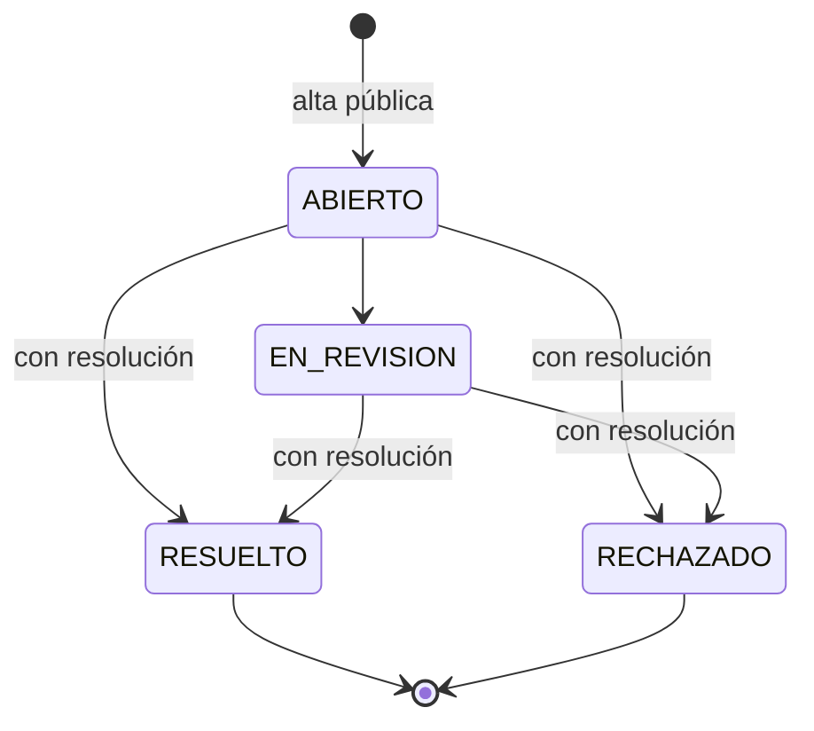

# HU07 — Iniciar un reclamo desde la vista pública del token

> Yo como usuario que consulta un envío deseo iniciar un reclamo desde la vista pública del token, para poder gestionar un inconveniente relacionado con el envío consultado.

Prioridad: **Media** · Estimación: **5 SP** · Contrato orientado a frontend: [`Back/Contrato/endpoints_frontend.md`, sección 11](../../Contrato/endpoints_frontend.md).

La bandeja interna para responder y cerrar reclamos es [HU17](./hu17-bandeja-reclamos.md).

## Endpoints

| Método | Ruta | Autenticación | Roles |
|:---|:---|:---|:---|
| `GET` | `/api/v1/reclamos/seguimiento/{token}` | No (público) | — |
| `POST` | `/api/v1/reclamos/seguimiento/{token}` | No (público) | — |
| `GET` | `/api/v1/admin/reclamos` | Sí (Bearer JWT) | `ADMINISTRATIVO`, `SUPERADMIN` |
| `GET` | `/api/v1/admin/reclamos/{id}` | Sí (Bearer JWT) | `ADMINISTRATIVO`, `SUPERADMIN` |
| `PATCH` | `/api/v1/admin/reclamos/{id}/estado` | Sí (Bearer JWT) | `ADMINISTRATIVO`, `SUPERADMIN` |

Router: [`app/api/v1/routers/reclamos.py`](../../app/api/v1/routers/reclamos.py) (dos `APIRouter`: el público y el de administración).

## Las dos mitades de la historia

El criterio de aceptación es corto — *"CUANDO selecciona la opción para realizar un reclamo ENTONCES el sistema habilita el inicio del reclamo para el envío consultado"* — pero el "para" de la historia es *poder gestionar un inconveniente*. Un reclamo que se guarda y nadie puede ver ni contestar no cumple ese objetivo, así que la historia se implementó completa:

1. **Habilitar e iniciar** (público, con el token): `GET` devuelve todo lo que el formulario necesita y `POST` registra el reclamo.
2. **Gestionar** (interno): una bandeja para el personal administrativo, con una máquina de estados y una resolución escrita que vuelve a la vista pública del token.

## Por qué el reclamo cuelga del token y no de una sesión

La vista de seguimiento (HU04) es pública: quien tiene el token no tiene cuenta. Por eso:

- La ruta es `/reclamos/seguimiento/{token}`: el token es la única "credencial" y el reclamo queda asociado **al envío de ese token** (`reclamos.envio_id`), que es literalmente lo que pide el criterio ("para el envío consultado").
- Los datos de contacto se cargan en el reclamo mismo (`contacto_nombre`, `contacto_email`, `contacto_telefono`), tal como estaba previsto en el [plan de base de datos](../01-arquitectura/plan-base-de-datos-completo.md#37-reclamos--hu07-nueva). Es la única forma de responderle a quien reclamó.
- El token se normaliza igual que en HU04/HU09 (`codigos_rules.normalizar_token_seguimiento`): mayúsculas y sin espacios.

## `GET /reclamos/seguimiento/{token}` — habilitar el inicio

Responde con:

- `puede_iniciar` y `motivo_no_habilitado` (ver el tope de reclamos más abajo).
- `tipos_reclamo`: código + descripción legible de cada tipo (`DEMORA`, `DANIO`, `EXTRAVIO`, `OTRO`), para que el frontend no tenga que mantener los textos. Salen de `reclamo_rules.DESCRIPCIONES_TIPO_RECLAMO`, y un test unitario verifica que estén todos los valores de `TipoReclamoEnum`.
- `paquetes`: los paquetes del envío, para elegir el afectado.
- `reclamos`: los reclamos ya iniciados para ese envío con su estado y resolución. Sirve para que quien consulta vea si su problema ya está en curso antes de reclamar de nuevo, y es donde ve la respuesta cuando se cierra.

Un token inexistente responde `404 NOT_FOUND` con el mismo mensaje que HU04.

## `POST /reclamos/seguimiento/{token}` — reglas del alta

| Regla | Respuesta si no se cumple | Dónde vive |
|:---|:---|:---|
| `tipo` válido (se acepta en minúsculas) | `400`, campo `tipo` | contrato + `reclamo_rules` |
| `descripcion` de 20 a 2000 caracteres (después de recortar espacios) | `400`, campo `descripcion` | contrato |
| Al menos un medio de contacto: email o teléfono | `400`, campo `contacto` | `validar_contacto_reclamo` |
| Teléfono con formato razonable (dígitos, espacios, guiones, paréntesis, `+` inicial, mínimo 6 dígitos) | `400`, campo `contacto_telefono` | `validar_contacto_reclamo` |
| `numero_paquete`, si se indica, pertenece a **este** envío | `400`, campo `numero_paquete` | servicio |
| No hay otro reclamo **activo** del mismo tipo sobre el mismo objetivo (paquete o envío completo) | `409 DUPLICATE_ENTRY`, campo `tipo` | `es_reclamo_duplicado` |
| El envío tiene menos de `MAX_RECLAMOS_ACTIVOS_POR_ENVIO` (5) reclamos activos | `400`, campo `token` | `evaluar_habilitacion_reclamo` |

El reclamo nace en `ABIERTO`. La respuesta pública **no** incluye los datos de contacto.

### Por qué hay un tope y un anti-duplicado

El endpoint es público y sin autenticación: cualquiera con el token puede reclamar. El anti-duplicado evita que el mismo problema (por ejemplo, "demora del paquete X") quede cargado varias veces mientras se está atendiendo; el tope evita que un envío se llene de reclamos. Ninguna de las dos reglas bloquea un reclamo legítimo nuevo: se puede reclamar otro tipo, otro paquete, o el mismo motivo después de que el reclamo anterior se cerró (hay un test que lo verifica).

## Gestión interna y máquina de estados



- Las transiciones están en `reclamo_rules.TRANSICIONES_RECLAMO` y se validan con `validar_transicion_reclamo`.
- **Cerrar exige `resolucion`** (mínimo 10 caracteres): es el texto que ve quien reclamó en la vista pública.
- Los estados cerrados no tienen salida. Si el problema reaparece, se inicia un reclamo nuevo; así lo que ya se respondió no se reescribe.
- `usuario_resolucion_id` registra quién tomó o cerró el reclamo por última vez.
- La bandeja (`GET /admin/reclamos`) filtra por `estado`, `tipo` y `token`, ordena del más reciente al más antiguo y sí incluye contacto, remitente y destinatario.

Solo `ADMINISTRATIVO` y `SUPERADMIN`: atender reclamos es una tarea administrativa, no de mostrador (`VENDEDOR`) ni de reparto (`REPARTIDOR`).

## Privacidad

Igual que HU04 y HU09: la parte pública no expone email, teléfono ni documento de nadie, tampoco los datos de contacto que dejó quien reclamó (el token lo comparten remitente y destinatario). La descripción y la resolución sí se muestran, porque son el contenido del reclamo sobre ese envío.

## Estructura por capas

```text
api/v1/routers/reclamos.py                       # router público + router de administración
application/services/servicio_reclamos.py        # caso de uso
application/interfaces/servicio_reclamos.py      # IServicioReclamos
application/interfaces/repositorio_reclamos.py   # IRepositorioReclamos
infrastructure/repositories/repositorio_reclamos.py
contracts/reclamos.py                            # schemas Pydantic
domain/rules/reclamo_rules.py                    # tipos, tope, duplicados, contacto, transiciones (sin I/O)
```

El envío se resuelve con `IRepositorioEnvios.obtener_por_token`, el mismo de HU04: no hizo falta una consulta nueva. No hubo cambios de esquema: la tabla `reclamos` ya existía.

## Cobertura de los criterios de aceptación

| Escenario de HU07 | Dónde se cumple | Test |
|:---|:---|:---|
| **Escenario 1** — con un token válido, al elegir reclamar se habilita el inicio del reclamo | `obtener_inicio_reclamo` | `test_hu07_escenario_1_acceso_a_reclamo_desde_seguimiento` |
| **Escenario 1** — el reclamo queda para el envío consultado | `crear_reclamo` asocia `envio_id` del token | `test_hu07_escenario_1_el_reclamo_queda_asociado_al_envio_consultado` |

## Tests

- [`tests/unit/test_reclamo_rules.py`](../../tests/unit/test_reclamo_rules.py) — 29 casos: tipos, tope, duplicados, contacto y toda la matriz de transiciones.
- [`tests/integration/test_hu07_reclamos.py`](../../tests/integration/test_hu07_reclamos.py) — 14 casos: el escenario, token inexistente y en minúsculas, reclamo por paquete, paquete de otro envío, contacto obligatorio, validaciones, duplicado, tope, autorización de la bandeja, filtros, ciclo completo hasta `RESUELTO` visto desde la vista pública y 404.
- El flujo de punta a punta ([`test_flujo_punta_a_punta.py`](../../tests/integration/test_flujo_punta_a_punta.py)) inicia y resuelve un reclamo sobre un envío que pasó por HU03, HU06 y HU10.

## Lo que esta historia deja pendiente

- **No se notifica por email** la creación ni la resolución del reclamo. La tabla `notificaciones_envio` está pensada para el token de HU05 (su `destinatario_tipo` solo admite `REMITENTE`/`DESTINATARIO`), así que avisar a un contacto de reclamo necesita decidir dónde se audita ese envío. El enganche natural es `BackgroundTasks` + `IEmailProvider`, como en `POST /envios`.
- **Sin rate limiting por IP.** El tope por envío acota el abuso sobre un mismo token, pero no reemplaza un límite de requests (`slowapi`) si el endpoint se expone a internet.
